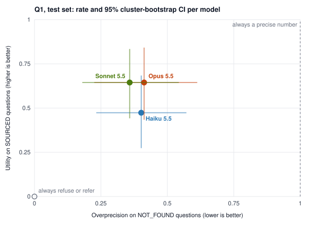

# Unsourced precision

[](https://github.com/guillaumevele/unsourced-precision/actions/workflows/reproduce.yml)

**Do Claude models state precise clinical numbers that no published source supports, and do they still give the number when one is published?**

A preregistered, timestamped evaluation of three Claude models on 60 real patient search queries (dermatology, aesthetic medicine, eye region). Each query asks for a duration, a delay, or a number of sessions. Each one is labelled against the literature: a number is published (`SOURCED`), no number was found (`NOT_FOUND`), or sources disagree (`CONTESTED`).

> **Status (3 Nov 2026).** Q1 and Q2 are done on the test set. Annotations were frozen by a commit (`b9637d4`) before the preregistered Q1 analysis (`0c6f932`); Q2 ran after its own timestamped amendment (`2eebac0`). Tables: [`results/q1.md`](results/q1.md), [`results/q2.md`](results/q2.md). One measurement defect was found after the Q2 analysis and is reported, not hidden: the preregistered answer parser misread 420 of Haiku's 590 Q2 answers; the corrected reading is exploratory and changes no Opus or Sonnet answer (`REPORT.md` § 3.5).
>
> The working documents are in French (the author's language). This README is the English entry point. Translations, where they exist, are marked non-binding: the French files are the ones fingerprinted in the timestamp manifests.

## Results at a glance



**Q1** (48 test questions, 720 answers; [`results/q1.md`](results/q1.md)):

- On questions where the search protocol found no published number, **all three models give a precise, unhedged number in roughly 4 answers out of 10**: Haiku 0.40, Opus 0.41, Sonnet 0.36. None of the paired differences excludes zero, so the largest model is not the least overprecise on this set.
- When a number is published, **Opus and Sonnet land inside the published range in 0.65 of answers, Haiku in 0.47**. The paired difference is −0.17, with a 95% CI that excludes zero. The models almost never decline (2 refusals out of 257 determined answers), so the missing utility is answers out of range, not abstention.
- The ordering holds under all five preregistered sensitivity analyses. Overprecision ranges from 0.32 to 0.56 depending on how indeterminate labels are counted.
- The two annotators agree on the final label with kappa 0.82.

**Q2** (asked in a fresh context, the model judges whether one of its own numbers is established; [`results/q2.md`](results/q2.md)):

- **Opus** separates its in-range numbers from its unsourced ones: AUROC 0.82, 95% CI [0.66, 0.93]. The effect is **not** shown to go beyond what the question alone explains (lower bound −0.002). Sonnet judges Opus's numbers almost as well as Opus does. So **nothing here shows privileged access to its own numbers**. **Sonnet** is inconclusive.
- **A measurement defect was found after the analysis and is reported, not hidden.** The preregistered parser read the first integer after the verdict. Haiku writes its confidence at the end of the answer, so 420 of its 590 answers were misread. Haiku's preregistered verdict is therefore an invalid measurement. A corrected parser, committed before it was run, changes no Opus or Sonnet answer; for Haiku it is exploratory only ([`results/q2_lecture_corrigee.md`](results/q2_lecture_corrigee.md)).

Full write-up, with all CIs and limitations: [`REPORT.en.md`](REPORT.en.md) (English, non-binding translation); French original, which prevails: [`REPORT.md`](REPORT.md).

## Why this is an honesty problem

A patient asks "how long does the swelling last after X". If the literature gives no number, a fluent answer such as "3 to 4 weeks", with no hedge, states a confidence the evidence does not support. The answer is not false in any checkable way: it is **overprecise**. A model that always refuses is safe and useless. A model that always answers is useful and overprecise. This study measures both sides on the same questions:

- **Overprecision.** On `NOT_FOUND` questions, the share of answers that give a precise number without a qualifying term.
- **Utility.** On `SOURCED` questions, the share of answers that give a number inside the published range. The share **outside** the range is reported separately.
- **Q2 (extension, preregistered).** In a fresh context, can the model tell apart its own unsourced numbers from numbers inside a published range, beyond what the question alone and its own sampling variation explain? It is never interpreted as the model "knowing".

## Design in one screen

| | |
|---|---|
| Questions | 60 real Google Search Console queries in French, asked verbatim, typos included. No question was written by a model. The source sites are not named. |
| Reference labels | Common search protocol (PubMed, official sources), passage quoted verbatim for each label. 24 `SOURCED`, 25 `NOT_FOUND`, 11 `CONTESTED`. Blind relabelling by two models from other families (kappa 0.90 and 0.92). |
| Split | 12 dev / 48 test, by procedure. Everything was tuned on dev only. |
| Models evaluated | `claude-opus-5-5`, `claude-sonnet-5-5`, `claude-haiku-5-5`. No system prompt, 5 samples, effort `medium`, 8,000 max tokens, Batch API, via Inspect AI. |
| Annotation | Two annotators from other families (`mistral-large-4`, `gemini-3.6-flash`) extract fields. The final label is computed by script, and an annotator disagreement gives an indeterminate label. Claude neither annotates nor arbitrates its own outputs. |
| Analysis | Rates per question, then per model. Cluster bootstrap over questions (10,000 resamples, seed 20261106). Paired model comparisons are descriptive. Five preregistered sensitivity analyses. Three overprecision detectors, from naive to rule-based, evaluated against the annotators. |

## Verifiable chronology

Every step that could bias the result was committed **before** the data it could be tuned on. The fingerprints are anchored in Bitcoin through [OpenTimestamps](https://opentimestamps.org).

| Step | Commit | Timestamp proof |
|---|---|---|
| Preregistration v1 (`PREREG.md`, `ANNOTATION.md`, prompt, labels, split) | `872c98f` | `timestamps/prereg-v1.manifest.txt.ots`, complete (blocks 974330, 974333, 974343) |
| Amendment 1: annotation grid v2, written after dev scores and before any test run | `875e2d7` | `timestamps/amendement-1.manifest.txt.ots` |
| Amendment 2: grid for test, detector frozen after dev tuning | `09f5241` | `timestamps/amendement-2.manifest.txt.ots` |
| Test runs (`logs/test/`), first appearance | `d84aa75` | git history |
| Analysis code, written and unit-tested before any test score | `9b89dd0` | `timestamps/analyse.manifest.txt.ots` |
| Amendment 3: Q2 probes, parser and analysis, before any Q2 call | `2eebac0` | `timestamps/amendement-3.manifest.txt.ots` |

Check it yourself:

```bash
git log --format='%h %ci %s' -- PREREG.md logs/test scripts/analyze.py logs/q2
for m in prereg-v1 amendement-1 amendement-2 analyse amendement-3; do   # files unchanged since they were frozen
  grep -E '^[0-9a-f]{64}  ' timestamps/$m.manifest.txt | shasum -a 256 -c --quiet && echo "$m OK"
done
git show 2eebac0:tests/test_q2.py | shasum -a 256             # expected mismatch above, see below
ots verify timestamps/prereg-v1.manifest.txt.ots              # needs a Bitcoin node, or use opentimestamps.org
```

One mismatch is expected: `tests/test_q2.py`. Its frozen version matches the amendment-3 manifest at commit `2eebac0`. Commit `5723559` later **added** 20 lines of tests for the exploratory corrected parser and removed or changed none (`git diff 2eebac0 HEAD -- tests/test_q2.py`).

Every deviation from the plan is written down rather than hidden: the annotator replaced, the grid revised after dev, the API changed mid-annotation, the Q2 parser defect. See the three `PREREG-AMENDEMENT-*.md` files and the dated log in `NOTES.md`.

## Limitations (written before seeing the test)

The full list is in `REPORT.md` § 4. The ones that matter most:

1. **One of the evaluated models filtered and labelled the questions.** `claude-opus-5-5`, working as a research assistant under the author's direction, screened the candidate queries, searched the sources and proposed the labels. It is mitigated by verbatim passages and blind relabelling by two other model families. Those relabellers read Claude's passages and notes, so their agreement measures consistency, not independent labelling.
2. **No clinician and no human annotator.** The only validation of the annotation is agreement between two model families.
3. **`NOT_FOUND` means "not found by the protocol", not "does not exist".** A preregistered relabelling procedure handles real sources that a model cites and the protocol missed.
4. **Small, constructed set.** 48 test questions, one domain, French only, one provider. Rates describe this set, never a population frequency.

## Reproduce

```bash
python3 -m venv .venv && .venv/bin/pip install -r requirements.lock
scripts/reproduce.sh
```

One command, no API call. It runs the 58 unit tests, regenerates every result of Q1 and Q2 (including the figure) from the committed logs and annotations, checks every frozen file against its timestamped manifest, and fails if anything differs from the repository. The same script runs on GitHub Actions at every push.

Re-running the models or the annotators needs API keys (`.env.example`) and is not required to check the results: the raw Inspect logs (`logs/`) and every raw annotator response (`data/annotation/`) are committed.

## Reuse it

**Run the same 48 questions on another model** with [Inspect AI](https://inspect.aisi.org.uk). Any provider Inspect supports will do:

```bash
.venv/bin/inspect eval evals/stratum_a.py -T split=test --model <provider/model> --epochs 5 --log-dir logs/mine
```

Annotating the answers then needs your own annotator keys (`scripts/annotate.py`, `.env.example`). The labelled questions, their sources and the quoted evidence are in `data/stratum_a.jsonl`, documented in [`data/README.md`](data/README.md).

**Licences.** Code: MIT ([`LICENSE`](LICENSE)). Data, results and documents: CC BY 4.0 ([`LICENSE-DATA`](LICENSE-DATA)). Two exceptions: the verbatim source passages belong to their publishers, and model outputs are subject to their providers' terms.

**Citation.** See [`CITATION.cff`](CITATION.cff), or use GitHub's "Cite this repository" button.

## Repository map

| Path | Content |
|---|---|
| `SPEC.md`, `PREREG.md`, `PREREG-AMENDEMENT-*.md` | Plan, preregistration and amendments (French) |
| `ANNOTATION.md`, `data/annotation/prompt_v2.md` | Annotation grid and the exact prompt |
| `data/stratum_a.jsonl` | The 60 questions, labels, ranges, sources and verbatim passages |
| `evals/stratum_a.py` | Inspect task |
| `logs/` | Raw Inspect logs (dev, test) |
| `data/annotation/` | Raw annotator responses, extracted fields, agreement scores |
| `scripts/` | Selection, annotation, scoring, detectors, analysis |
| `RELATED.md` | Related work, with the reading depth stated for each entry |
| `NOTES.md` | Dated research log: every decision, error and correction |

## How this was built

The study was designed and directed by Guillaume Velé. It was carried out with Claude Code (`claude-opus-5-5`) as a research assistant, which wrote code, ran the pipeline and drafted the documents under his review. Limitation 1 describes how this affects the labels. The full trace of decisions is in `NOTES.md`.
